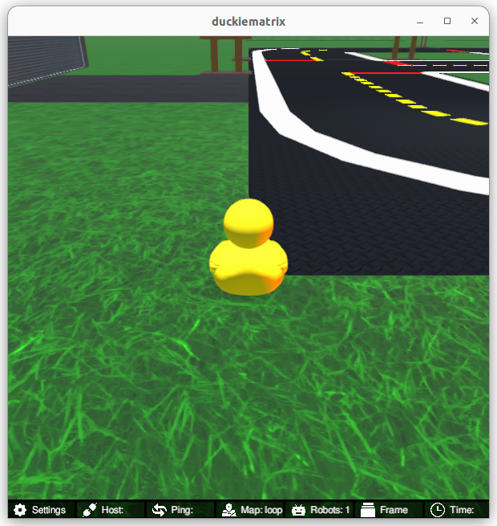
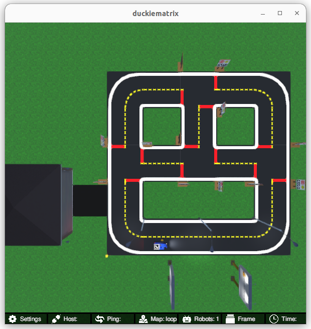

<p align="center">
<a href="https://duckietown.com"></a>
</p>

# Learning Experience (LX): Computer Vision

In this learning experience, we will see how to process the data captured by the camera in order to build a basic reactive controller for our Duckiebot.

Find the most up-to-date instructions on [how to run LXs on the Duckietown manual](https://docs.duckietown.com/ente/duckietown-manual/60-learning-experiences/lx-setup-pid-control.html). 

**NOTE:** All commands below are intended to be executed from the root directory of this exercise (i.e., the directory containing this `README`).

## 1. Make sure your exercise is up-to-date

Update your exercise definition and instructions,

    git pull upstream ente

**NOTE:** to pull from upstream, you need to have completed the instructions in the [duckietown-lx repository README](https://github.com/duckietown/duckietown-lx/blob/mooc2022/README.md) to *fork* this repository.


## 2. Make sure your system is up-to-date

- 💻 Always make sure your Duckietown Shell is updated to the latest version (see the [installation instructions](https://github.com/duckietown/duckietown-shell)):

```
pipx upgrade duckietown-shell
```

This exercise is meant to be run with the `ente` version of the shell commands. You can switch to that version with `dts profile switch ente`. 

- 💻 Update the shell commands: `dts update`

- 💻 Make sure all the Docker images on your computer are up to date: `dts desktop update`

- 🚙 Update your Duckiebot: `dts duckiebot update ROBOTNAME` (where `ROBOTNAME` is the name of your (real or virtual - more on this later) Duckiebot chosen during the initialization procedure.)

## 3. Calibrate your camera

Since every camera may be manufactured slightly differently and mounted in a slightly different position on the robot, you need to calibrate it. This consists of two parts:

- intrinsic camera calibration
- extrinsic camera calibration

Follow [these instructions](https://docs.duckietown.com/ente/duckietown-manual/20-operations/04-calibrations/duckiebot-camera-calibration.html) for both parts.

## 4. Work on the exercise


### Launch the code editor

Open the code editor (VSCode) by running the following command,

```
dts code editor
```

Wait for a URL to appear on the terminal, then click on it or copy-paste it in the address bar
of your browser to access the code editor. The first thing you will see in the code editor is
this same document, you can continue there.


### Walkthrough of notebooks

**NOTE**: You should be reading this from inside the code editor in your browser.

Inside the code editor, use the navigator sidebar on the left-hand side to navigate to the
`notebooks` directory and open the first notebook.

Follow the instructions on the notebook and work through the notebooks in sequence.

Once you have completed all the tasks in the notebooks, you can follow the instructions below to test your code.


### Testing with Duckiematrix

It can be useful to test your code in a simulation environment before trying it on the real robot. For this, we have the Duckiematrix.

In order to test your code in the Duckiematrix you will need a virtual robot. You can create one with the command:

```
dts duckiebot virtual create --type duckiebot --configuration DB21J [VBOT]
```

where `[VBOT]` is the hostname. It can be anything you like, with [some constraints](https://docs.duckietown.com/ente/duckietown-manual/10-setup/03-duckiebot/flashing-sd-card-duckiebot-initialization-complete.html). Make sure to remember your robot (host)name for later.

Then you can start your virtual robot with the command:

```
dts duckiebot virtual start [VBOT]
```

You should see it with a status `Booting` and finally `Ready` if you look at `dts fleet discover`: 

```
       | Hardware |   Type    | Model |  Status  | Hostname 
---    | -------- | --------- | ----- | -------- | ---------
[VBOT] |  virtual | duckiebot | DB21J |  Ready   | [VBOT].local
```

Now that your virtual robot is ready you can start the Duckiematrix. From this exercise directory do:

```
dts code start_matrix
```

You should see the Unity-based Duckiematrix simulator start up. The startup screen will look like:



From here, you can click anywhere on the window and click [ENTER] to make it become active. From here, you can move the duckie towards the Duckiebot with the 'w', 'a', 's', and 'd' keys or you can move the camera angle to view the Duckiebot with the mouse. Alternatively, you can change to an overhead view by pressing 'v', which will give you a view that looks like this:




### Building your code

You can build your code with 

```
dts code build -R ROBOT_NAME
```

where `ROBOT_NAME` can be a real or a virtual robot. This will build a docker image with your code compiled inside - you should see your ROS node get built during the process. 


### 💻 Testing 


You can then run your code with

```
dts code workbench -R ROBOT_NAME [-m]
```

where `ROBOT_NAME` can be a real or a virtual robot; if it is a virtual robot, add the `-m` option to run it in the Duckiematrix.


In another terminal, you can launch the `noVNC` viewer for this exercise:

```
dts code vnc -R [ROBOT_NAME]
```

where `[ROBOT_NAME]` could be the real or the virtual robot (use whichever you ran the `dts code workbench` and `dts code build` command with).

In the noVNC desktop, click on the icon marked "VLS - Visual Lane Servoing Exercise" and then you should follow the prompts
in the terminal where you ran `dts code workbench`.

Now you can proceed to the [first notebook](./notebooks/01-Pinhole-Camera/pinhole_camera_matrix.ipynb).

## Credits

This exercise was originally developed by [Andrea Daniele](https://afdaniele.com/) and [Matthew Walter](https://home.ttic.edu/~mwalter/).
